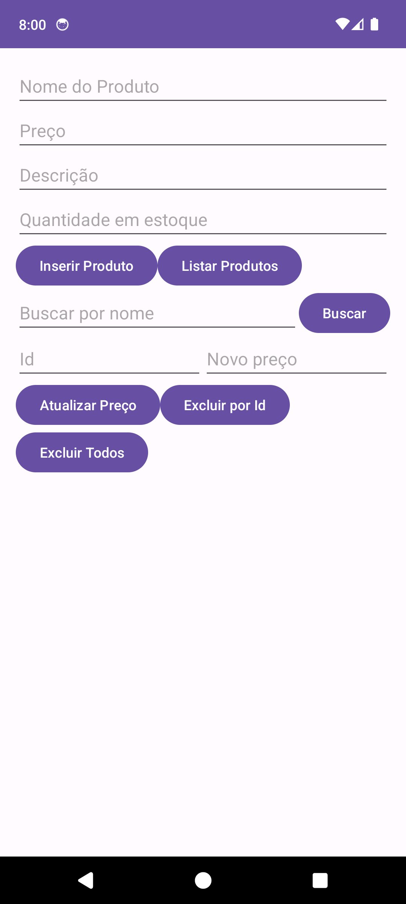
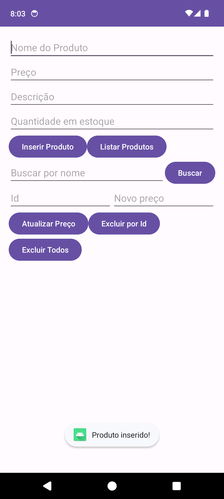
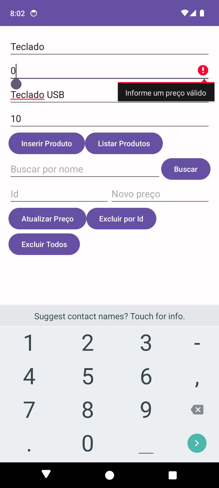
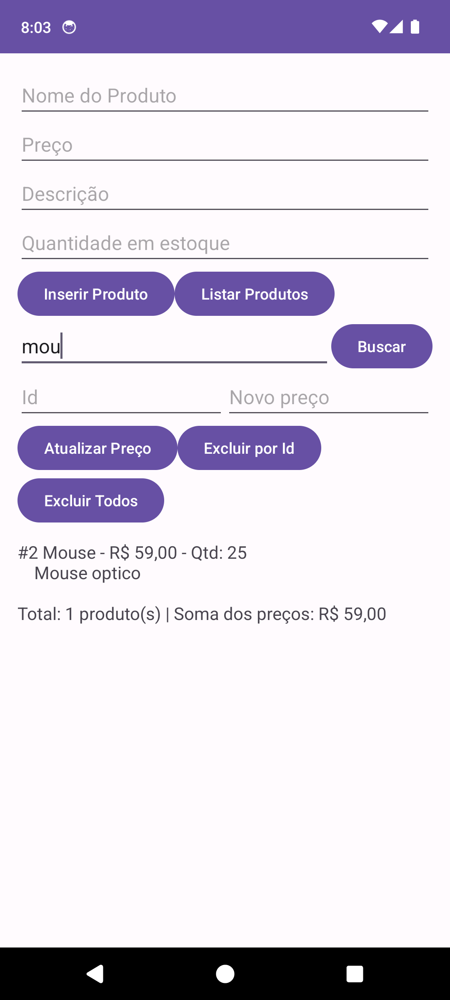
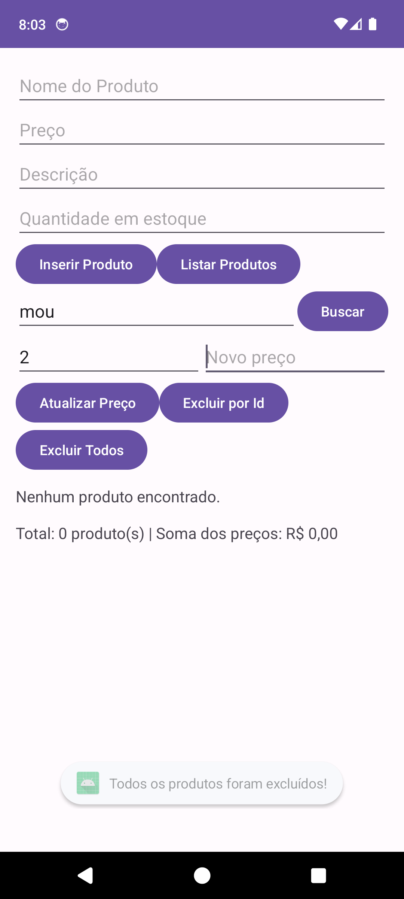
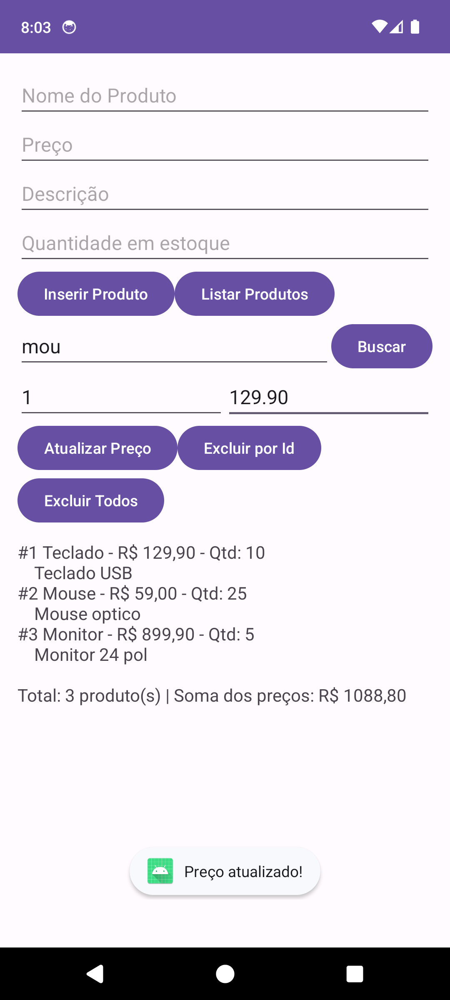

# AppRoomProduto: Cadastro de Produtos com Room SQLite

**Aluno(a):** Flávia Valéria Leandro da Silva
**RA:** 243440
**Disciplina:** Programação para Dispositivos Móveis
**Professor(a):** Alessandro Ferreira Paz de Lima

## Sobre o projeto
Aplicativo Android em Kotlin que cadastra, lista, busca, atualiza e exclui produtos
usando persistência local com Room (SQLite).

## Tecnologias
- Kotlin
- Room 2.8.4 (SQLite) com KSP
- ViewBinding
- Corrotinas (lifecycleScope)

> **Observação sobre versões:** o tutorial usa Room 2.6.1 + `kapt`. Este projeto usa o Android Gradle Plugin 9, cujo Kotlin embutido não é compatível com o `kapt`, então usei **KSP** e subi o Room para 2.8.4 (o 2.6.1 com KSP falhava com `unexpected jvm signature V`). O código das anotações (`@Entity`, `@Dao`, `@Database`) é o mesmo.

## Prints do app

Saída real do Logcat (filtro `tag:TAG`), capturada no emulador:

```
I TAG     : Produto inserido: Teclado - R$149.9
I TAG     : Produto inserido: Mouse - R$59.0
I TAG     : Produto inserido: Monitor - R$899.9
I TAG     : Produto = Teclado, Preço = R$149.9, Descrição = Teclado USB, Qtd = 10
I TAG     : Produto = Mouse, Preço = R$59.0, Descrição = Mouse optico, Qtd = 25
I TAG     : Produto = Monitor, Preço = R$899.9, Descrição = Monitor 24 pol, Qtd = 5
I TAG     : Produto = Mouse, Preço = R$59.0, Descrição = Mouse optico, Qtd = 25
I TAG     : Produto = Teclado, Preço = R$129.9, Descrição = Teclado USB, Qtd = 10
I TAG     : Produto = Mouse, Preço = R$59.0, Descrição = Mouse optico, Qtd = 25
I TAG     : Produto = Monitor, Preço = R$899.9, Descrição = Monitor 24 pol, Qtd = 5
I TAG     : Produto = Teclado, Preço = R$129.9, Descrição = Teclado USB, Qtd = 10
I TAG     : Produto = Monitor, Preço = R$899.9, Descrição = Monitor 24 pol, Qtd = 5
```

Arquivo completo: [docs/prints/logcat.txt](docs/prints/logcat.txt)

## Parte A: Complemento prático

### A1. Limpar campos após inserir
**O que foi feito:** após o `insertAll` terminar com sucesso, os campos Nome, Preço, Descrição e Quantidade são limpos e o cursor volta ao campo Nome.

```kotlin
productDao.insertAll(product)
binding.editProductName.text.clear()
binding.editProductPrice.text.clear()
binding.editProductDescription.text.clear()
binding.editProductQuantity.text.clear()
binding.editProductName.requestFocus()
```
Print: 

### A2. Validação de preço
**O que foi feito:** o preço é convertido com `toDoubleOrNull()` (aceita vírgula). Se for vazio, inválido, zero ou negativo, o erro aparece no próprio campo e nada é salvo.

```kotlin
val price = parsePreco(binding.editProductPrice.text.toString())
if (price == null || price <= 0) {
    binding.editProductPrice.error = "Informe um preço válido"
    return
}
```
Print: 

### A3. Lista na tela
**O que foi feito:** um `TextView` (`txtResultado`) abaixo dos botões mostra a lista ao clicar em Listar Produtos (o Logcat continua recebendo os logs).

```kotlin
binding.btnListarProdutos.setOnClickListener {
    lifecycleScope.launch { mostrarLista(productDao.getAll()) }
}
```
Print: 

### A4. Total do estoque
**O que foi feito:** junto da lista aparece a quantidade de produtos e a soma dos preços.

```kotlin
binding.txtResultado.text =
    "$linhas\n\nTotal: ${products.size} produto(s) | Soma dos preços: R$ ${formata(products.sumOf { it.price })}"
```
Print: 

### A5. Buscar por nome
**O que foi feito:** novo método no DAO, campo "Buscar por nome" e botão Buscar. O `%texto%` faz a busca por nomes parecidos.

```kotlin
@Query("SELECT * FROM product WHERE name LIKE :nome")
suspend fun buscarPorNome(nome: String): List<Product>

// na Activity
mostrarLista(productDao.buscarPorNome("%$texto%"))
```
Print: 

### A6. Excluir produtos
**O que foi feito:** botão **Excluir Todos** (`deleteAll`) e, como desafio extra, botão **Excluir por Id** usando `@Delete` (busca o produto por id com `getById` e o remove).

```kotlin
@Query("DELETE FROM product")
suspend fun deleteAll()

@Delete
suspend fun delete(product: Product)
```
Print: 

### A7. Atualizar produto
**O que foi feito:** o usuário informa o id e o novo preço; o app busca o produto, cria uma cópia com o preço novo (`copy`) e grava com `@Update`.

```kotlin
@Update
suspend fun update(product: Product)

// na Activity
productDao.update(produto.copy(price = novoPreco))
```
Print: 

### A8. Novo campo `quantity`
**O que foi feito:** a entidade ganhou `quantity: Int = 0`, o layout ganhou o campo "Quantidade em estoque" e a `version` do `@Database` foi para 2.

```kotlin
@ColumnInfo(name = "quantity") val quantity: Int = 0

@Database(entities = [Product::class], version = 2)
```
**O que aconteceu com os produtos já cadastrados:** foram **apagados**. O Room guarda a versão do esquema no arquivo do banco. Ao abrir o app, ele viu que o arquivo era versão 1 e o código pedia a 2. Como não existe uma `Migration` de 1 para 2, e o banco é criado com `fallbackToDestructiveMigration`, o Room apaga todas as tabelas e as recria com a nova estrutura, perdendo os dados. Sem esse método, o app fecharia com `IllegalStateException` por falta de migração.

Print: 

## Parte B: Questões dissertativas

> Rascunho a ser revisado e reescrito com as palavras do aluno antes da entrega.

### B1. O que é persistência de dados? O que aconteceria com uma `MutableList` na `MainActivity`?
**Resposta:** Persistência de dados é a capacidade de guardar informações de forma que elas continuem existindo depois que o app é fechado, o celular reinicia ou o processo é encerrado pelo sistema. No meu projeto isso é feito pelo Room, que grava os produtos em um arquivo SQLite no armazenamento do aparelho. Se eu guardasse os produtos só em uma `MutableList` dentro da `MainActivity`, eles ficariam apenas na memória RAM. Bastaria girar a tela, o que recria a Activity, ou fechar o app, para a lista voltar vazia e todos os cadastros se perderem. Por isso, no teste do tutorial, os produtos continuam aparecendo ao clicar em Listar mesmo depois de reabrir o app: eles estão no banco, não na memória da Activity.

### B2. Diferença entre SQLite direto e Room; duas vantagens do Room
**Resposta:** Com o SQLite direto eu preciso criar uma classe `SQLiteOpenHelper`, escrever os comandos `CREATE TABLE`, `INSERT` e `SELECT` como texto, percorrer o `Cursor` coluna por coluna e converter tudo para objetos manualmente. Qualquer erro de digitação em uma string SQL só aparece quando o app roda. O Room é uma camada sobre o SQLite que automatiza isso. Uma vantagem é a verificação em tempo de compilação: se a query do `@Query` estiver errada ou referenciar uma tabela inexistente, o build falha antes de eu executar o app. Outra é a redução de código repetitivo: no meu `ProductDao` o `@Insert` gera o INSERT sozinho e o `getAll()` já devolve uma `List<Product>`, sem eu mexer em `Cursor`. O Room também tem suporte nativo a corrotinas (`suspend`) e a migrações.

### B3. Papel de Entity, DAO e Database
**Resposta:** A Entity é a classe que representa a tabela. No projeto, `Product` com `@Entity` vira a tabela `product`, e cada atributo (`id`, `name`, `price`, `description`, `quantity`) vira uma coluna, com `id` como chave primária autogerada. O DAO é a interface com as operações permitidas no banco; o `ProductDao` declara inserir, listar, buscar por nome, atualizar e excluir, e o Room escreve a implementação. O Database, `AppDatabase`, junta tudo: a anotação `@Database(entities = [Product::class], version = 2)` diz quais tabelas existem e a função abstrata `productDao()` entrega o DAO. Na `MainActivity` eu crio o banco com `Room.databaseBuilder`, pego o DAO e uso para operar sobre objetos `Product`.

### B4. Thread principal, ANR, `suspend` e `lifecycleScope.launch`
**Resposta:** A thread principal (UI thread) é a que desenha a tela e responde aos toques. Acessar o banco é uma operação de disco, que pode demorar; se rodasse nessa thread, a interface congelaria enquanto o banco responde. Por isso o Room lança "Cannot access database on the main thread". Se a UI thread ficar bloqueada por alguns segundos (cerca de 5 s para eventos de entrada), o Android mostra um ANR (Application Not Responding), o diálogo dizendo que o app não está respondendo, oferecendo fechá-lo. No meu projeto as funções do DAO são `suspend`, o que permite ao Room executá-las fora da thread principal e retomar a corrotina quando terminam. O `lifecycleScope.launch` abre essa corrotina presa ao ciclo de vida da Activity, então a tela continua fluida e o trabalho é cancelado automaticamente se a Activity for destruída.

### B5. `fallbackToDestructiveMigration()` e Migration
**Resposta:** Esse método diz ao Room o que fazer quando a versão do banco no aparelho é diferente da versão do código e não existe uma migração definida: ele apaga todas as tabelas e cria o banco de novo, vazio. Foi o que aconteceu no item A8, quando passei a `version` de 1 para 2 e perdi os produtos cadastrados. Em um app publicado na Play Store isso é perigoso, porque cada atualização que mudar o esquema apagaria os dados de todos os usuários, como pedidos, cadastros e histórico, sem aviso. Uma migração (`Migration`) é um script que ensina o Room a passar de uma versão para outra preservando os dados, por exemplo `ALTER TABLE product ADD COLUMN quantity INTEGER NOT NULL DEFAULT 0` para ir da versão 1 para a 2. Ela é registrada com `addMigrations(...)` no builder.

### B6. ViewBinding vs `findViewById`
**Resposta:** O ViewBinding gera, em tempo de compilação, uma classe para cada layout (aqui `ActivityMainBinding`) com uma propriedade para cada view que tem id. Em vez de procurar a view com `findViewById(R.id.xxx)` e converter o tipo, eu escrevo `binding.editProductName` e já recebo um `EditText`. Isso evita erros que só apareceriam em execução: `NullPointerException` por procurar um id que não existe naquele layout, e `ClassCastException` por tratar uma view como o tipo errado. Se eu renomear ou remover um id no XML, o código que o usa deixa de compilar e o erro aparece na hora. Também deixa o código mais curto e legível, sem `findViewById` repetido em cada tela.

### B7. Banco como Singleton
**Resposta:** Criar o banco dentro da `MainActivity`, como no tutorial, funciona para um app de uma tela, mas em apps maiores é recomendado ter uma única instância (Singleton) para o app inteiro. Cada `RoomDatabase` é pesado: abre conexões com o arquivo, mantém cache e threads. Se cada tela criasse o seu, o app gastaria memória à toa e haveria várias instâncias apontando para o mesmo arquivo. Isso pode causar travamentos de escrita (`database is locked`), e as telas não saberiam das mudanças feitas pelas outras, já que os mecanismos de observação do Room ficam por instância. No meu projeto o banco é criado a cada abertura da Activity, o que é aceitável aqui, mas num app real eu criaria o banco uma vez, por exemplo em um `companion object` com `@Volatile` e `synchronized` ou via injeção de dependência (Hilt).

### B8. Reflexão pessoal
**Resposta:** Preencher com a experiência real. Pontos que realmente aconteceram neste projeto e podem ser citados: (1) o projeto usa AGP 9, então o `kapt` do tutorial não funcionou e tive que migrar para o KSP; (2) com o KSP e o Room 2.6.1 o build falhou com `unexpected jvm signature V`, e resolvi atualizando o Room para 2.8.4; (3) o layout ganhou vários campos e precisei de um `ScrollView` para tudo caber na tela. Um app real em que o Room seria útil: um app de controle de estoque para uma loja pequena, que guardaria produtos, quantidades e preços no aparelho, funcionaria sem internet, e permitiria buscar por nome, atualizar o estoque a cada venda e avisar quando a quantidade ficasse baixa.

## Como executar
1. Clone o repositório
2. Abra no Android Studio
3. Execute em um emulador (API 24+)
